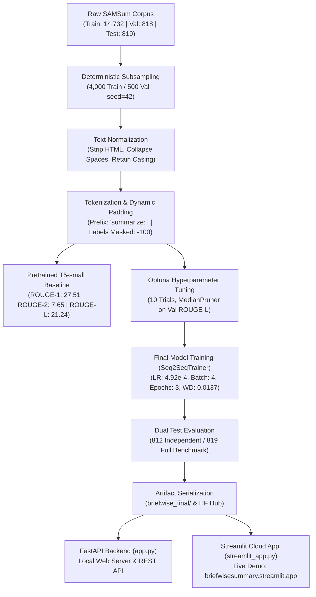

# BriefWise: Dialogue Summarization with Fine-Tuned T5-Small

[](https://briefwisesummary.streamlit.app/)
[](https://github.com/kaifbaig/BriefWise)
[](https://www.python.org/)
[](https://pytorch.org/)
[](https://huggingface.co/docs/transformers)
[](https://fastapi.tiangolo.com/)
[](https://streamlit.io/)
[](https://optuna.org/)

> 🚀 **Live Demo:** **[https://briefwisesummary.streamlit.app/](https://briefwisesummary.streamlit.app/)**  
> *Test the fine-tuned dialogue summarization model live in your web browser.*

An end-to-end Natural Language Processing (NLP) system fine-tuning Google's **T5-small** sequence-to-sequence model on the SAMSum corpus for multi-turn conversational dialogue summarization. BriefWise transforms colloquial multi-speaker transcripts into concise, grammatically structured third-person summaries.

The model is deployed on **Streamlit Community Cloud** (securely loading model weights from authenticated private storage), accompanied by a local **FastAPI** backend and responsive HTML interface for offline execution.

---

## Try BriefWise

Experience the model directly on **Streamlit Community Cloud** without local installation:

👉 **[Launch Live Web Demo](https://briefwisesummary.streamlit.app/)**

1. **Select an Input:** Choose a preset conversation (*Lunch Meeting Plan*, *Project Deadline Update*, or *Travel & Flight Coordination*) or paste your own multi-speaker chat transcript.
2. **Summarize:** Click **Summarize Conversation** to run 4-beam search inference.
3. **Inspect Output:** View the synthesized summary, check word reduction metrics, and copy the result with one click.

*(To run the application locally via Streamlit, FastAPI, or Docker, see [Section 11: Installation & Setup](#11-installation--setup).)*

---

## 1. Overview

Conversational text differs fundamentally from standard expository prose. Real-world dialogues feature informal language, slang, turn-taking dynamics, incomplete sentences, and context distributed across multiple speakers. Standard pretrained language models without domain adaptation often struggle with these patterns, frequently extracting disconnected verbatim quotes rather than synthesizing key outcomes.

**BriefWise** addresses this challenge by fine-tuning an encoder-decoder Transformer (**T5-small**) on conversational transcripts. The project covers the complete applied machine learning lifecycle: exploratory data analysis, dynamic sequence collation, Bayesian hyperparameter optimization with Optuna, rigorous ROUGE benchmarking against a pretrained baseline, error analysis, and dual deployment via a FastAPI backend and a public Streamlit web application.

---

## 2. Objective

The primary objective is to develop, tune, and evaluate an accessible sequence-to-sequence dialogue summarization pipeline within realistic academic compute constraints:

1. **Domain Adaptation:** Fine-tune pretrained T5-small weights to generate coherent, third-person summaries from casual multi-speaker dialogues.
2. **Methodological Rigor:** Implement Hugging Face's `Seq2SeqTrainer` with dynamic batch padding via `DataCollatorForSeq2Seq` and loss masking on padding tokens (`-100`).
3. **Automated Hyperparameter Optimization:** Systematically search learning rates, batch sizes, weight decay, and epochs using Optuna's Bayesian search evaluated on validation ROUGE-L.
4. **Transparent Benchmark Evaluation:** Benchmark the fine-tuned model against the pretrained T5 baseline across both the full benchmark test split and a strictly non-overlapping held-out split.
5. **Interactive Deployment:** Deliver two deployment interfaces: a public web demo on Streamlit Community Cloud and a local FastAPI backend with a custom HTML/JS interface.

---

## 3. Dataset

The project uses the benchmark **SAMSum Corpus** (Samsung Messenger Dataset), composed of realistic multi-turn dialogues with human-written third-person summaries:

- **Full Benchmark Splits:**
  - **Training Set (`samsum-train.csv`):** 14,732 dialogues
  - **Validation Set (`samsum-validation.csv`):** 818 dialogues
  - **Test Set (`samsum-test.csv`):** 819 dialogues (held out for final evaluation)
- **Deterministic Subsampling (`random_state=42`):** To balance training efficiency and GPU compute constraints, representative subsets were drawn for experimentation:
  - **Training Subset:** 4,000 dialogues (~27% of raw training data)
  - **Validation Subset:** 500 dialogues (~61% of raw validation data)
  - **Test Set:** 819 dialogues (evaluated on both full and disjoint partitions)
- **Cross-Split Overlap Disclosure:** SAMSum contains documented duplicate dialogues across splits. In BriefWise's 4,000-example training subset, exactly **7 dialogues (0.85%)** appear identically in the test set. To ensure evaluation transparency, results are reported for both the full 819-sample test set and the strictly independent **812-dialogue non-overlapping test set**.

---

## 4. Project Workflow



---

## 5. Model Architecture & Preprocessing

### 5.1 Architecture
BriefWise uses **T5-small** (Text-to-Text Transfer Transformer), an encoder-decoder architecture with approximately **60.5 million parameters**:
- **Encoder:** 6 Transformer blocks with self-attention and feed-forward sublayers.
- **Decoder:** 6 Transformer blocks with masked self-attention, cross-attention over encoder states, and a shared language modeling head (`lm_head`).
- **Vocabulary:** 32,128 SentencePiece subword tokens.

### 5.2 Preprocessing Pipeline
1. **Task Instruction Prefix:** Every dialogue input is prepended with `"summarize: "` to explicitly invoke T5's summarization conditional generation head.
2. **Casing Preservation:** Casing is preserved. T5's SentencePiece tokenizer is case-sensitive; retaining capitalization improves named-entity recognition (speaker names, locations).
3. **Whitespace Normalization:** Regular expressions strip residual HTML tags and collapse erratic whitespace into single spaces.
4. **Sequence Length Boundaries:**
   - **Dialogue Inputs (`max_length=512`):** Preserves almost all conversational context while keeping sequence lengths manageable during training and inference.
   - **Summary Targets (`max_length=150`):** Accommodates 100% of reference summaries (maximum observed length: 94 tokens).

---

## 6. Training & Hyperparameter Optimization

Hyperparameter tuning was conducted using **Optuna** integrated directly into Hugging Face's `Seq2SeqTrainer`. Each trial initialized fresh base model weights via `model_init` to prevent inter-trial weight leakage.

### 6.1 Validation Strategy & Search Space
- **Validation Metric:** `eval_rougeL` computed on generated summaries across the 500-sample validation subset using beam search (`num_beams=4`).
- **Pruning Strategy:** Optuna's `MedianPruner` evaluated intermediate performance at each epoch, automatically terminating unpromising trials after Epoch 1 (saving substantial compute).

| Hyperparameter | Search Range / Options | Distribution | Best Selected Value (Trial 8) |
| :--- | :---: | :---: | :---: |
| **`learning_rate`** | `1e-5` to `1e-3` | Log-uniform | **`4.92e-4` (`0.0004919`)** |
| **`weight_decay`** | `0.0` to `0.1` | Uniform | **`0.01366`** |
| **`per_device_train_batch_size`** | `[2, 4, 8]` | Categorical | **`4`** |
| **`num_train_epochs`** | `[2, 5]` | Integer | **`3`** |

### 6.2 Training Progression
With the selected hyperparameters, final training progressed over 3 epochs with steady validation ROUGE-L improvement:
- **Epoch 1:** `37.93`
- **Epoch 2:** `39.03`
- **Epoch 3:** **`39.76`** (exported as the final model from `checkpoint-3000`)

---

## 7. Results & Evaluation

The fine-tuned model was evaluated against the pretrained T5-small baseline using beam search (`num_beams=4`, `max_new_tokens=100`, input truncation at 512 tokens).

### 7.1 Baseline vs. Fine-Tuned Model Comparison

ROUGE scores measure n-gram lexical overlap between model-generated and reference summaries (`use_stemmer=True`). Performance on the **strictly independent held-out split (812 dialogues)**:

| Metric | Pretrained T5-small Baseline | Fine-Tuned BriefWise | Improvement |
| :--- | :---: | :---: | :---: |
| **ROUGE-1** | 27.51 | **46.88** | **+19.37 pts** |
| **ROUGE-2** | 7.65 | **22.51** | **+14.86 pts** |
| **ROUGE-L** | 21.24 | **38.45** | **+17.21 pts** |

### 7.2 Evaluation Split Comparison & Overlap Transparency

To ensure complete scientific transparency, evaluation was conducted across both partitions:

| Evaluation Partition | Dialogues | ROUGE-1 | ROUGE-2 | ROUGE-L | Description |
| :--- | :---: | :---: | :---: | :---: | :--- |
| **Independent Held-Out** | **812** | **46.88** | **22.51** | **38.45** | Strictly disjoint from training data (primary benchmark) |
| **Full Test Set** | 819 | 46.91 | 22.56 | 38.50 | Complete `samsum-test.csv` benchmark split |
| **Overlapping Subset** | 7 | 54.31 | 25.30 | 42.84 | Dialogues present in training sample |

> [!NOTE]
> **Evaluation Transparency:** Seven dialogues in the test set also appeared in the training subset. These overlapping samples achieved higher ROUGE scores than the independent test partition. To avoid overstating generalization performance, the primary benchmark uses the 812 strictly non-overlapping dialogues. Full per-dialogue predictions and evaluation metrics are preserved in the linked [CSV](./briefwise_nonoverlap_predictions.csv) and [JSON](./briefwise_nonoverlap_metrics.json) files.

### 7.3 Key Findings
1. **Substantial Bigram Overlap (+14.86 pts ROUGE-2):** Pretrained T5-small achieved very low ROUGE-2 (7.65) because it primarily copied dialogue fragments verbatim. Fine-tuning increased bigram overlap to 22.51, reflecting the model's ability to synthesize connected, informative phrases.
2. **Grammatical Restructuring:** Converts raw colloquial turns into coherent, third-person sentences with correct grammatical subjects.

---

## 8. Error Analysis

Qualitative inspection of generated summaries highlights key linguistic failure modes common to compact sequence-to-sequence models:

1. **ROUGE vs. Factuality:** ROUGE measures n-gram overlap, not factual correctness. A summary can achieve high ROUGE scores by matching keywords while misrepresenting the core event.
2. **Speaker Attribution Confusion:** In rapid multi-speaker exchanges, the model occasionally attributes an agreed-upon action to the wrong person.
3. **Temporal & Schedule Inversion:** When plans change mid-conversation (*"Meeting at 2? Actually, let's do 3"*), the model sometimes retains the superseded time or combines both.
4. **Detail Omission:** Secondary logistics or incidental remarks are frequently dropped in favor of a single high-level statement.

---

## 9. Web Application

BriefWise provides two deployment interfaces sharing identical preprocessing and beam search generation settings:

```
[Client / Browser]
        │
        ├── HTTP POST /summarize/ ──> [FastAPI Backend: app.py] ──> [T5 Model (briefwise_final/)]
        │                                                                │
        └── Streamlit UI (Port 8501) ──> [streamlit_app.py] ─────────────┘ (Cached via @st.cache_resource)
```

### 9.1 Streamlit Cloud Application (`streamlit_app.py`)
- **Live URL:** **[briefwisesummary.streamlit.app](https://briefwisesummary.streamlit.app/)**
- **Dual Loading Strategy:** Automatically loads from `./briefwise_final/` when local weights exist; in cloud environments, securely fetches model weights from private Hugging Face storage using an authenticated `HF_TOKEN` secret.
- **Resource Caching:** Wrapped with `@st.cache_resource` to ensure the ~60M parameter model and tokenizer load into memory once per container lifecycle.
- **Interactive UI:** Includes multi-speaker conversation presets, character counters, compression statistics, and one-click clipboard copying.

### 9.2 FastAPI Backend & HTML Interface (`app.py` & `index.html`)
- **REST API:** Exposes a `POST /summarize/` endpoint accepting JSON payloads (`{"dialogue": "..."}`).
- **Input Validation:** Enforces character boundaries (1 to 20,000 characters) via Pydantic schemas.
- **Non-Blocking Inference:** Runs model generation inside a synchronous threadpool worker to avoid blocking FastAPI's asynchronous event loop.
- **Frontend:** Pure HTML5, CSS3, and JavaScript interface with XSS-safe DOM rendering (`.textContent`).

---

## 10. Project Structure

```
BriefWise/
├── app.py                               # FastAPI backend and /summarize/ endpoint
├── index.html                           # Responsive HTML5/JS frontend
├── streamlit_app.py                     # Streamlit web application (Local & Cloud)
├── text_summarizer_mine.ipynb           # Machine learning notebook (EDA, tuning, training)
├── requirements.txt                     # Application runtime dependencies
├── Dockerfile                           # Container deployment specification
├── .dockerignore                        # Docker build exclusion rules
├── .gitignore                           # Git ignore rules (weights, caches, secrets)
├── README.md                            # Project documentation
│
├── .streamlit/                          # Streamlit configuration directory
│   └── secrets.toml.example             # Secrets template for Hugging Face read token
│
├── briefwise_nonoverlap_predictions.csv # Per-dialogue test predictions & overlap flags
├── briefwise_nonoverlap_metrics.json    # Evaluated test metrics across splits
│
├── briefwise_final/                     # Model architecture and tokenizer artifacts
│   ├── config.json                      # T5-small model architecture config
│   ├── generation_config.json           # Beam search generation configuration
│   ├── tokenizer.json                   # Fast tokenizer merge and vocabulary table
│   └── tokenizer_config.json            # Tokenizer settings
│
├── samsum-train.csv                     # SAMSum training split (14,732 samples)
├── samsum-validation.csv                # SAMSum validation split (818 samples)
└── samsum-test.csv                      # SAMSum test split (819 samples)
```

---

## 11. Installation & Setup

### Prerequisites
- Python 3.10 or higher
- Git

### Setup Steps

1. **Clone the repository:**
   ```bash
   git clone https://github.com/kaifbaig/BriefWise.git
   cd BriefWise
   ```

2. **Create and activate a virtual environment:**
   ```bash
   # Windows (PowerShell)
   python -m venv .venv
   .\.venv\Scripts\Activate.ps1

   # Linux / macOS
   python3 -m venv .venv
   source .venv/bin/activate
   ```

3. **Install dependencies:**
   ```bash
   pip install --upgrade pip
   pip install -r requirements.txt
   ```

4. **Model Weights Setup:**
   Because `briefwise_final/model.safetensors` (~242 MB) exceeds GitHub's 100 MB per-file limit, weights are stored separately:
   - **Local execution:** Place your trained `model.safetensors` inside `./briefwise_final/`.
   - **Remote execution:** Copy `.streamlit/secrets.toml.example` to `.streamlit/secrets.toml` and provide an authenticated Hugging Face read token (`HF_TOKEN`) to download weights dynamically.

5. **Run the application:**

   - **Option A: Streamlit Web Interface (Recommended)**
     ```bash
     streamlit run streamlit_app.py
     ```
     Access at `http://localhost:8501`.

   - **Option B: FastAPI Backend & HTML Interface**
     ```bash
     python app.py
     # Or using uvicorn:
     python -m uvicorn app:app --host 127.0.0.1 --port 8000
     ```
     Access at `http://127.0.0.1:8000`.

   - **Option C: Docker Container**
     ```bash
     docker build -t briefwise .
     docker run -p 8000:8000 briefwise
     ```

---

## 12. Limitations & Future Improvements

### Limitations
- **Model Capacity:** At ~60M parameters, T5-small offers fast inference and low resource usage, but has more restricted reasoning depth than larger models (T5-base 220M, BART-large 406M).
- **Benchmark Overlap:** 7 of the 819 test dialogues appeared in the training subset due to pre-existing SAMSum benchmark duplicates.
- **Flattened Turn Boundaries:** Normalizing newlines into spaces flattens conversational turn markers, making speaker attribution harder.
- **Surface Evaluation Metric:** ROUGE scores reward lexical n-gram overlap rather than factual consistency.

### Future Improvements
- **Strict Cross-Split Deduplication:** Apply automated corpus-level deduplication prior to dataset splitting.
- **Preserved Speaker Delimiters:** Introduce dedicated speaker turn tokens (e.g., `[SPEAKER]` or `\n`) during tokenization.
- **Factuality Evaluation:** Incorporate rubric-based human factuality scoring or automated factual consistency metrics (e.g., QAGS or FactCC).
- **PEFT / LoRA Fine-Tuning:** Explore Parameter-Efficient Fine-Tuning (LoRA) on larger backbones such as FLAN-T5-base.

---

## 13. Technologies Used

- **Python:** 3.10+
- **PyTorch:** Deep learning framework and tensor operations
- **Hugging Face Transformers:** T5-small model architecture, tokenizer, and `Seq2SeqTrainer`
- **Optuna:** Bayesian hyperparameter optimization (`MedianPruner`)
- **ROUGE:** Evaluation metrics (`rouge-score` / `evaluate`)
- **FastAPI & Uvicorn:** Asynchronous backend and REST API
- **Streamlit:** Interactive web application framework and cloud deployment
- **Pandas & NumPy:** Dataset processing, sampling, and metric analysis
- **Docker:** Application containerization and reproducible deployment
