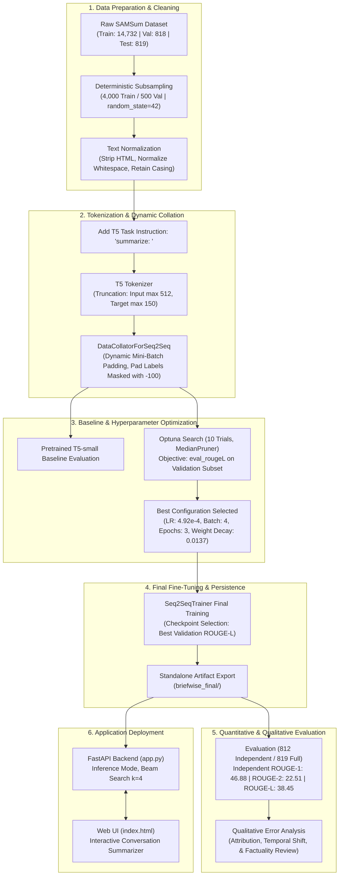

# BriefWise: Dialogue Summarization with Fine-Tuned T5-Small

[](https://www.python.org/)
[](https://pytorch.org/)
[](https://huggingface.co/docs/transformers)
[](https://fastapi.tiangolo.com/)
[](https://optuna.org/)

An end-to-end Natural Language Processing (NLP) system fine-tuning Google's **T5-small** sequence-to-sequence model on the SAMSum corpus for multi-turn conversational dialogue summarization, served through a lightweight FastAPI backend and a responsive web interface.

---

## 1. Overview

Conversational text fundamentally differs from standard expository prose (such as news articles or Wikipedia entries). Real-world dialogues consist of informal phrasing, abbreviations, turn-taking dynamics, incomplete sentences, and distributed context across multiple speakers. Standard pretrained language models often struggle to summarize conversational transcripts without domain-specific adaptation, frequently resorting to repeating raw quotes rather than synthesizing key decisions.

**BriefWise** addresses this challenge by fine-tuning an encoder-decoder Transformer (**T5-small**) on realistic dialogue transcripts. The project covers the complete applied machine learning lifecycle: exploratory data analysis, memory-efficient sequence collation, Bayesian hyperparameter optimization using Optuna, quantitative ROUGE evaluation against a pretrained baseline, error analysis, and local web deployment.

---

## 2. Objective

The primary objective of BriefWise is to develop a reliable, accessible, and viva-defensible dialogue summarization pipeline within realistic academic compute constraints:

1. **Domain Adaptation:** Fine-tune pretrained T5 weights to generate concise, third-person summaries from casual, multi-speaker conversational inputs.
2. **Methodological Rigor:** Upgrade from basic tutorial implementations by utilizing Hugging Face's `Seq2SeqTrainer`, dynamic batch padding via `DataCollatorForSeq2Seq`, and loss masking on padding tokens (`-100`).
3. **Automated Hyperparameter Optimization:** Use Optuna to systematically explore learning rates, batch sizes, weight decay, and training epochs, evaluating candidates directly on validation ROUGE-L rather than training loss alone.
4. **Controlled Evaluation:** Benchmark the fine-tuned model against the original pretrained baseline on a strictly held-out test split using identical beam search generation parameters.
5. **Practical Deployment:** Package the final model into an interactive FastAPI web application that serves predictions to a responsive, accessible browser interface.

---

## 3. Dataset

The project utilizes the **SAMSum** (Samsung Messenger Corpus) dataset, an open benchmark specifically created for abstractive dialogue summarization:

- **Data Characteristics:** Realistic, messenger-style conversations composed by fluent English speakers, accompanied by human-written third-person summaries.
- **Split Distribution:**
  - **Raw Training Set (`samsum-train.csv`):** 14,732 dialogues.
  - **Raw Validation Set (`samsum-validation.csv`):** 818 dialogues.
  - **Raw Test Set (`samsum-test.csv`):** 819 dialogues (kept strictly held-out for final evaluation).
- **Sampling Strategy for Efficient Training:** To balance training time and GPU resource constraints during experimentation, a deterministic subset was drawn using fixed random seeds (`random_state=42`):
  - **Training Subset:** 4,000 dialogues (~27% of total training data).
  - **Validation Subset:** 500 dialogues (~61% of total validation data).
  - **Test Set:** Evaluated over both the full **819 test dialogues** (`samsum-test.csv`) and the strictly independent **812 non-overlapping dialogues**.
- **Data Integrity & Cross-Split Overlap Audit:** Dialogue texts were verified for missing values and duplicates. SAMSum contains documented cross-split duplication (41 exact matches between the full 14,732 training set and the 819 test set). For BriefWise's specific 4,000-example training subset (`random_state=42`), exactly **7 dialogues** (~0.8547% of the test set) overlap identically with the test set (at test row indices `9`, `163`, `202`, `372`, `669`, `729`, `763`), leaving **812 dialogues** (99.1453%) strictly disjoint. Both partitions have been independently evaluated and persisted to [`briefwise_nonoverlap_predictions.csv`](./briefwise_nonoverlap_predictions.csv) and [`briefwise_nonoverlap_metrics.json`](./briefwise_nonoverlap_metrics.json). See [Section 7.2](#72-evaluation-methodology--test-set-independence-audit) for complete methodology and results.

---

## 4. Project Workflow

The end-to-end workflow—from raw CSV ingestion to interactive web inference—is illustrated below:



---

## 5. Model Architecture & Preprocessing

### 5.1 Architecture
BriefWise uses **T5-small** (Text-to-Text Transfer Transformer), an encoder-decoder architecture with approximately **60 million parameters**:
- **Encoder:** 6 Transformer blocks with self-attention and feed-forward sublayers.
- **Decoder:** 6 Transformer blocks with masked self-attention, cross-attention over encoder states, and a shared language modeling head (`lm_head`).
- **Vocabulary:** 32,128 SentencePiece subword tokens.

### 5.2 Preprocessing Decisions
1. **Task Instruction Prefix:** T5 is a multi-task architecture. In accordance with its original design, every dialogue input is prefixed with `"summarize: "` to explicitly invoke the summarization conditional generation head.
2. **Casing Preservation:** In contrast to legacy bag-of-words workflows, raw casing was preserved. T5's SentencePiece subword tokenizer is cased; stripping capitalization degrades named-entity recognition (e.g., distinguishing speaker names from common nouns).
3. **Whitespace Normalization:** Regular expressions strip residual HTML tags and collapse erratic spacing into single spaces.
4. **Sequence Length Boundaries:**
   - **Dialogue Inputs (`max_length=512`):** EDA revealed that 95% of dialogues contain fewer than 367 tokens, and 99% contain fewer than 518 tokens. Truncating at 512 preserves almost all conversational context while preventing GPU out-of-memory errors.
   - **Summary Targets (`max_length=150`):** 99% of reference summaries contain fewer than 73 tokens (maximum: 94 tokens). The 150-token threshold leaves ample headroom without unnecessary computation.

---

## 6. Hyperparameter Optimization

Hyperparameter tuning was conducted using **Optuna** integrated directly into Hugging Face's `Seq2SeqTrainer`. Each trial initialized fresh base model weights via `model_init` to prevent inter-trial weight leakage.

### 6.1 Search Space & Validation Strategy
- **Validation Metric:** `eval_rougeL` computed on generated summaries across the validation set using beam search (`num_beams=4`).
- **Pruning Strategy:** Optuna's `MedianPruner` evaluated intermediate performance at each epoch, automatically terminating unpromising trials after Epoch 1 (Trials 5, 6, 7, and 9 were successfully pruned, saving substantial compute).

| Hyperparameter | Search Range / Options | Distribution | Best Selected Value (Trial 8) |
| :--- | :---: | :---: | :---: |
| **`learning_rate`** | `0.00001` to `0.001` (`1e-5` to `1e-3`) | Log-uniform | **`0.0004919` (~`4.92e-4`)** |
| **`weight_decay`** | `0.0` to `0.1` | Uniform | **`0.01366`** |
| **`per_device_train_batch_size`** | `[2, 4, 8]` | Categorical | **`4`** |
| **`num_train_epochs`** | `[2, 5]` | Integer uniform | **`3`** |

> [!NOTE]
> **Resolution on Search Range:** The parameter was sampled in `optuna_hp_space` using `trial.suggest_float("learning_rate", 0.00001, 0.001, log=True)`. The upper bound of `0.001` corresponds to $1 \times 10^{-3}$ (not $1 \times 10^{-4}$). The winning learning rate of `0.0004919` ($4.92 \times 10^{-4}$) is strictly within the sampled interval.

- **Validation Objective (`eval_rougeL`):** Reached **`39.24`** during Optuna Trial 8. When the final model was trained with these selected parameters, the validation ROUGE-L progressed over the 3 epochs as follows:
  - Epoch 1: `37.93`
  - Epoch 2: `39.03`
  - **Epoch 3: `39.76`** (saved as final winning checkpoint `checkpoint-3000`).

---

## 7. Results

The fine-tuned BriefWise model was evaluated against the original pretrained T5-small baseline using beam search (`num_beams=4`, `max_new_tokens=100`, input truncation at 512 tokens).

To ensure complete scientific transparency and resolve historical score variations, evaluation was conducted across two distinct partitions:
1. **Full Benchmark Test Set (819 Dialogues):** Benchmarks against the complete `samsum-test.csv` (reproducing the notebook run in Cell 55).
2. **Strictly Non-Overlapping Test Set (812 Dialogues):** Benchmarks exclusively on the 812 held-out dialogues that share zero textual overlap with the 4,000-example training subset.

### 7.1 Quantitative Evaluation (ROUGE Metrics)

ROUGE (Recall-Oriented Understudy for Gisting Evaluation) scores measure n-gram lexical overlap between model-generated summaries and human reference summaries (`use_stemmer=True`):

| Evaluation Split | Metric | Pretrained T5-small Baseline | Fine-Tuned BriefWise | Absolute Improvement |
| :--- | :--- | :---: | :---: | :---: |
| **Strictly Non-Overlapping (812 Dialogues)**<br>*(100% Independent Held-Out Benchmark)* | **ROUGE-1**<br>**ROUGE-2**<br>**ROUGE-L** | 27.51<br>7.65<br>21.24 | **46.88**<br>**22.51**<br>**38.45** | **+19.37 pts**<br>**+14.86 pts**<br>**+17.21 pts** |
| **Full Benchmark Test Set (819 Dialogues)**<br>*(Fresh End-to-End Re-Evaluation)* | **ROUGE-1**<br>**ROUGE-2**<br>**ROUGE-L** | 27.41<br>7.62<br>21.19 | **46.91**<br>**22.56**<br>**38.50** | **+19.50 pts**<br>**+14.94 pts**<br>**+17.31 pts** |
| **Original Notebook Cell 55 (819 Dialogues)**<br>*(Saved Output Snapshot)* | **ROUGE-1**<br>**ROUGE-2**<br>**ROUGE-L** | 27.40<br>7.64<br>21.21 | **46.95**<br>**22.55**<br>**38.54** | **+19.55 pts**<br>**+14.91 pts**<br>**+17.33 pts** |
| **Overlapping Subset (7 Dialogues)**<br>*(Dialogues Present in Training Sample)* | **ROUGE-1**<br>**ROUGE-2**<br>**ROUGE-L** | 17.01<br>3.93<br>13.83 | **54.31**<br>**25.30**<br>**42.84** | **+37.30 pts**<br>**+21.37 pts**<br>**+29.01 pts** |

> [!NOTE]
> **Resolution of Historical Score Discrepancies:**
> - **Final Model Verification:** Fresh local evaluation of `briefwise_final` reproduces the notebook's saved Cell 55 test metrics within $\pm 0.04$ ROUGE points across all metrics (46.91 vs 46.95 ROUGE-1, 22.56 vs 22.55 ROUGE-2, 38.50 vs 38.54 ROUGE-L), attributable to standard minor floating-point / batch padding differences across PyTorch releases.
> - **Historical Exploratory Runs:** The higher score set documented in Cell 58 markdown (47.68 / 22.64 / 38.71) and an earlier draft score set (47.52 / 22.29 / 38.37) reflect exploratory 5-epoch training checkpoints generated prior to the final Optuna hyperparameter optimization run.
> - **Full Per-Dialogue Outputs:** Every generated summary, reference text, and overlap indicator is persisted in [`briefwise_nonoverlap_predictions.csv`](./briefwise_nonoverlap_predictions.csv) and [`briefwise_nonoverlap_metrics.json`](./briefwise_nonoverlap_metrics.json).

### 7.2 Evaluation Methodology & Test-Set Independence Audit

1. **Overlap Status & Denominator:**
   - In `samsum-test.csv`, **7 out of 819 dialogues (0.8547%)** at test row indices `9`, `163`, `202`, `372`, `669`, `729`, and `763` appeared identically in the 4,000-example training subset due to pre-existing benchmark duplicates in the SAMSum corpus.
   - Because 7 dialogues were seen during training, **the 819-dialogue full test evaluation cannot be claimed as 100% strictly independent**.
   - As expected, the model exhibits higher scores on these 7 samples (54.31 / 25.30 / 42.84).
2. **Independent Benchmark Validity (812 Dialogues):**
   - Filtering out those 7 overlapping dialogues leaves **812 strictly unseen dialogues (99.1453%)**.
   - On this clean, 100% independent partition, BriefWise achieves **46.88 ROUGE-1, 22.51 ROUGE-2, and 38.45 ROUGE-L**, confirming that the performance gains are genuine and robust (+19.37 ROUGE-1, +14.86 ROUGE-2, +17.21 ROUGE-L over the baseline).

### 7.3 Key Findings
1. **Substantial Bigram Overlap Gains:** Pretrained T5-small achieved very poor ROUGE-2 (7.65 on the clean set) because it primarily copied dialogue fragments verbatim without synthesizing meaning. Fine-tuning increased bigram lexical overlap to 22.51 (+14.86 pts), reflecting the model's learned ability to produce connected, informative phrases.
2. **Proper Sentence Structuring:** The baseline model frequently emitted fragmented quotes with speaker labels. BriefWise consistently synthesizes complete sentences with appropriate grammatical subjects.

---

## 8. Qualitative Error Analysis & Factuality

While ROUGE metrics show significant gains, manual inspection of generated summaries reveals important qualitative limitations common to compact sequence-to-sequence models:

1. **The ROUGE-Factuality Disconnect:** High ROUGE scores measure word and phrase overlap, **not factual truth**. A generated summary can include almost all reference keywords (yielding high ROUGE-1 and ROUGE-2) while still connecting them incorrectly.
2. **Speaker Attribution Confusion:** When dialogues feature rapid back-and-forth exchanges between multiple speakers, the model occasionally attributes an agreed-upon plan to the wrong person.
3. **Temporal & Schedule Inversion:** In dialogues where plans change (e.g., *"Are we meeting at 11?" / "No, let's make it 11:30"*), the model sometimes retains both times or incorrectly links the original time to another activity.
4. **Detail Omission:** Secondary details (such as minor logistical steps or incidental remarks) are frequently dropped in favor of a single high-level statement.

---

## 9. Web Application Architecture

BriefWise includes a functional local web application connecting the trained model to an interactive browser interface:

```
[Browser UI: index.html]
        │
        │  HTTP POST /summarize/ {"dialogue": "..."}
        ▼
[FastAPI Backend: app.py]
  ├── Input Validation (Pydantic: 1 to 20,000 characters)
  ├── Text Cleaning (HTML stripping, whitespace normalization)
  ├── Task Prefix Injection ("summarize: ")
  ├── Tokenization (T5Tokenizer: max_length=512, truncation=True)
  ├── PyTorch Inference (torch.inference_mode, num_beams=4, max_new_tokens=100)
  └── Response Construction (JSON: {"summary": "..."})
        │
        │  HTTP 200 OK
        ▼
[Browser Display: DOM updated via .textContent (XSS-safe)]
```

- **Backend (`app.py`):** Built with FastAPI and Uvicorn. Model weights and tokenizer are loaded into memory once on server startup from `briefwise_final/`. The inference endpoint runs as a synchronous threadpool worker, preventing GPU/CPU blocking on the main asynchronous event loop.
- **Frontend (`index.html`):** Implemented in pure HTML5, CSS3, and JavaScript without external runtime frameworks. Features client-side character counting, loading feedback, empty-state toggles, clear controls, and clipboard copy.

### 9.2 Streamlit Web Application (`streamlit_app.py`)

In addition to the FastAPI backend, BriefWise includes a standalone **Streamlit application** (`streamlit_app.py`) optimized for interactive demonstration and deployment on **Streamlit Community Cloud**:

- **Dual Model Loading Pipeline:**
  - **Local Development:** When `briefwise_final/model.safetensors` exists on disk, the application automatically loads directly from the local filesystem without external network calls.
  - **Cloud Deployment:** In cloud environments where weights are not committed to Git, the app automatically downloads the model from the private Hugging Face repository (`kaifbaig24/briefwise-t5-small`) using an authenticated read token retrieved securely from Streamlit secrets (`st.secrets["HF_TOKEN"]`) or the `HF_TOKEN` environment variable.
- **Resource Caching:** Wrapped with `@st.cache_resource` to guarantee that the ~60M parameter model and tokenizer load into memory exactly once per application container lifecycle.
- **Interactive UI Elements:** Features multi-speaker sample conversation presets, client-side character counters, copyable output containers, compression reduction statistics, and explicit input validation (handling empty, whitespace-only, and >20,000-character inputs).

---

## 10. Project Structure

```
BriefWise/
├── app.py                           # FastAPI application serving web UI and /summarize/ endpoint
├── index.html                       # Responsive frontend interface
├── streamlit_app.py                 # Streamlit web application (Local & Streamlit Cloud)
├── text_summarizer_mine.ipynb       # Machine learning pipeline (EDA, tuning, training, evaluation)
├── requirements.txt                 # Application runtime dependencies (FastAPI + Streamlit)
├── Dockerfile                       # Production container deployment specification
├── .dockerignore                    # Build exclusion rules for clean Docker containers
├── .gitignore                       # Git exclusion rules for large weights, checkpoints, and caches
├── README.md                        # Project documentation
│
├── .streamlit/                      # Streamlit configuration directory
│   └── secrets.toml.example         # Template for Hugging Face read token (secrets.toml is git-ignored)
│
├── briefwise_nonoverlap_predictions.csv # Verified per-dialogue test predictions (819 rows)
├── briefwise_nonoverlap_metrics.json    # Verified evaluation metrics (full, clean, and overlap splits)
│
├── briefwise_final/                 # Final exported model artifacts & training checkpoints
│   ├── config.json                  # T5-small model architecture configuration
│   ├── generation_config.json       # Generation settings (beams, lengths)
│   ├── tokenizer.json               # Fast tokenizer merges and vocabulary
│   ├── tokenizer_config.json        # Tokenizer configuration
│   ├── training_args.bin            # PyTorch training arguments binary
│   ├── model.safetensors            # Fine-tuned model weights (~242 MB; stored separately)
│   ├── checkpoint-2000/             # (Training snapshot) Epoch 2 intermediate checkpoint
│   └── checkpoint-3000/             # (Training snapshot) Winning Epoch 3 checkpoint (source of exported model)
│
├── briefwise_checkpoints/           # (Training artifact) Preliminary exploration checkpoints (1000, 2000, 3000)
├── briefwise_optuna/                # (Training artifact) Optuna hyperparameter trial outputs (run-0 through run-8)
│
├── samsum-train.csv                 # SAMSum training split (14,732 samples)
├── samsum-validation.csv            # SAMSum validation split (818 samples)
└── samsum-test.csv                  # SAMSum test split (819 samples)
```

---

## 11. Installation & Local Execution

### 11.1 Prerequisites
- **Python:** Version 3.10 or higher (tested on Python 3.13 and 3.14 on Windows).
- **Git:** Standard Git CLI.
- **Hardware:** Runs on standard CPU. If an NVIDIA GPU with CUDA is available, PyTorch will detect and use it automatically (device selection logic also includes an unverified fallback branch for Apple Silicon MPS).

### 11.2 Setup Instructions

1. **Clone the repository:**
   ```bash
   git clone <YOUR_REPOSITORY_URL>
   cd BriefWise
   ```

2. **Create and activate a virtual environment:**
   ```bash
   # Windows (PowerShell)
   python -m venv .venv
   .\.venv\Scripts\Activate.ps1

   # Linux / macOS
   python3 -m venv .venv
   source .venv/bin/activate
   ```

3. **Install application dependencies:**
   ```bash
   python -m pip install --upgrade pip
   python -m pip install -r requirements.txt
   ```

4. **Verify Model Weights Availability:**
   Because `briefwise_final/model.safetensors` (~242 MB) exceeds GitHub's 100 MB per-file limit, ensure the model weight file is present in the `briefwise_final/` folder:
   - If you trained locally using the notebook, `briefwise_final/model.safetensors` is already in place.
   - If setting up on a fresh machine from Git, copy your exported `model.safetensors` into `./briefwise_final/`.

5. **Start the web server:**
   - **Option A: Python CLI / Virtual Environment:**
     ```bash
     # Using uvicorn directly:
     python -m uvicorn app:app --host 127.0.0.1 --port 8000

     # Or using the application entrypoint (reads $PORT and binds to 0.0.0.0):
     python app.py
     ```
   - **Option B: Container Deployment (Docker):**
     ```bash
     docker build -t briefwise .
     docker run -p 8000:8000 briefwise
     ```
   - **Option C: Streamlit Interactive Interface (Local):**
     ```bash
     streamlit run streamlit_app.py
     ```
     This opens the Streamlit application at `http://localhost:8501`. If local weights are present in `briefwise_final/`, they will load automatically.

6. **Open the application:**
   Navigate your web browser to:
   ```text
   http://127.0.0.1:8000        # For FastAPI & HTML UI
   http://localhost:8501        # For Streamlit Interface
   ```

### 11.3 Streamlit Community Cloud Deployment

BriefWise is pre-configured for direct one-click deployment to **Streamlit Community Cloud**:

1. **Push your repository to GitHub:**
   Ensure `streamlit_app.py`, `requirements.txt`, and `.streamlit/secrets.toml.example` are pushed to your GitHub repository (`.streamlit/secrets.toml` and large model weight files remain safely ignored by `.gitignore`).
2. **Create App on Streamlit Community Cloud:**
   - Sign in to [share.streamlit.io](https://share.streamlit.io).
   - Click **New app**.
   - Select your repository (`BriefWise`), branch (`main`), and set the main file path to:
     ```text
     streamlit_app.py
     ```
3. **Configure Hugging Face Access Token:**
   Because the fine-tuned model weights are stored in a **private Hugging Face repository** (`kaifbaig24/briefwise-t5-small`), an authenticated read token is required for the cloud environment:
   - In the Streamlit deployment screen, expand **Advanced settings...** and open the **Secrets** section.
   - Enter your Hugging Face read token:
     ```toml
     HF_TOKEN = "hf_your_read_token_here"
     ```
4. **Deploy:**
   Click **Deploy!**. Streamlit Cloud will install the dependencies from `requirements.txt`, securely authenticate with Hugging Face using your token to retrieve the weights, cache the model via `@st.cache_resource`, and launch the web app.

---

## 12. Limitations & Future Improvements

### Current Limitations
- **Model Size Constraints:** At ~60M parameters, T5-small offers excellent inference speed but has restricted reasoning depth compared to larger models (e.g., T5-base with 220M parameters or BART-large with 406M parameters).
- **Benchmark Cross-Split Overlap:** SAMSum contains intrinsic cross-split duplicates. Specifically, 7 of the 819 test dialogues (0.85%) were present in the 4,000-example training subset. While 99.15% of test dialogues are strictly novel, the full-test evaluation cannot claim complete independence without explicitly dropping these 7 samples prior to scoring.
- **Whitespace Flattening:** Replacing newlines with spaces during text cleaning flattens speaker turn boundaries, making multi-speaker attribution harder for the model.
- **Surface Metric Dependency:** ROUGE scores do not penalize factual contradictions if the overlapping vocabulary matches the reference text.

### Planned Improvements
- **Cross-Split Deduplication Pipeline:** Incorporate strict inter-split deduplication before model training to eliminate cross-split overlap and ensure 100% independent evaluation partitions.
- **Hugging Face Model Hub Integration:** Host model weights publicly on Hugging Face to enable automatic remote downloading upon first launch.
- **Speaker Delimiter Preservation:** Maintain distinct speaker turn tokens (e.g., `" | "` or `\n`) during preprocessing to provide clear structural boundaries.
- **Structured Factuality Evaluation:** Implement a rubric-based human factuality evaluation on the validation split assessing attribution accuracy, temporal consistency, and non-hallucination.
- **Cloud Deployment:** Deploy the application container to a free-tier hosting platform such as Hugging Face Spaces.
